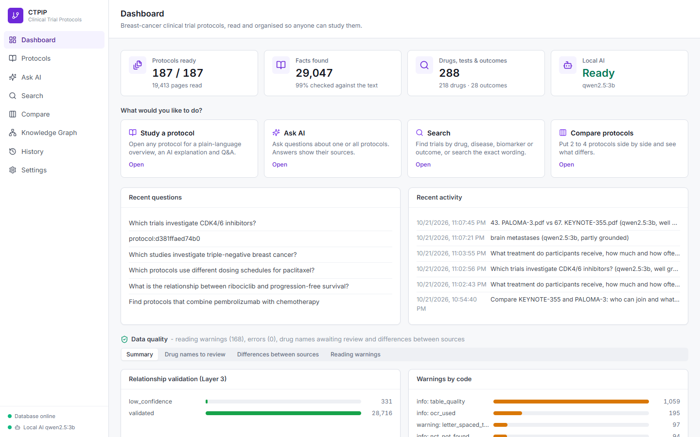
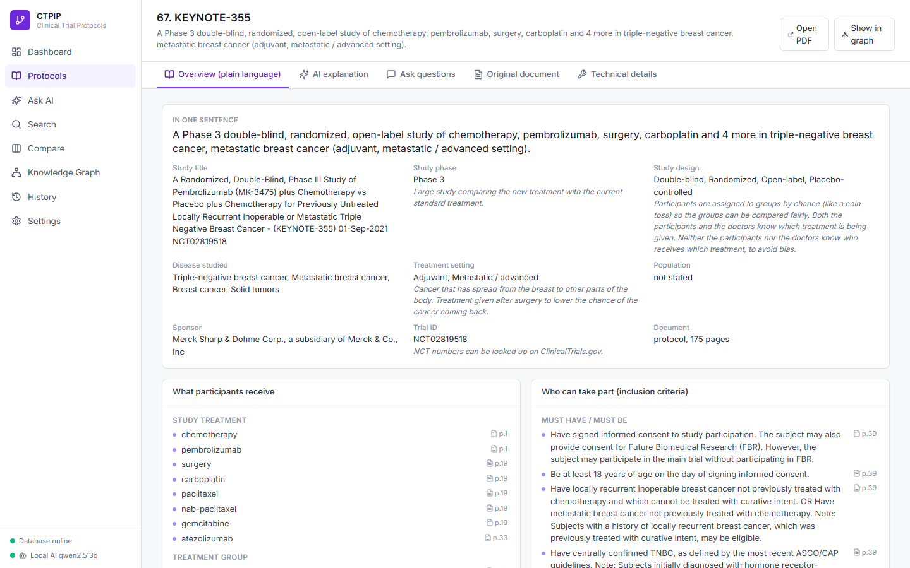
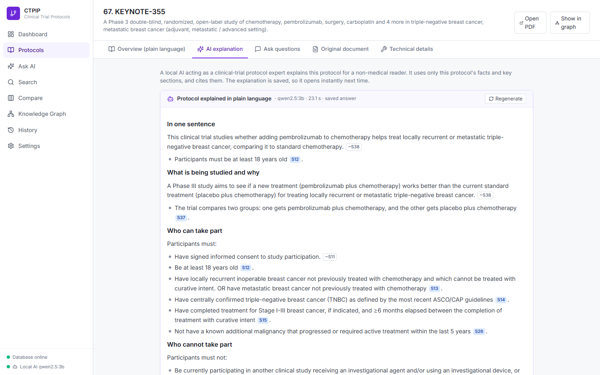
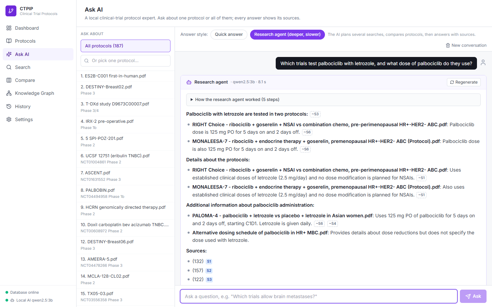
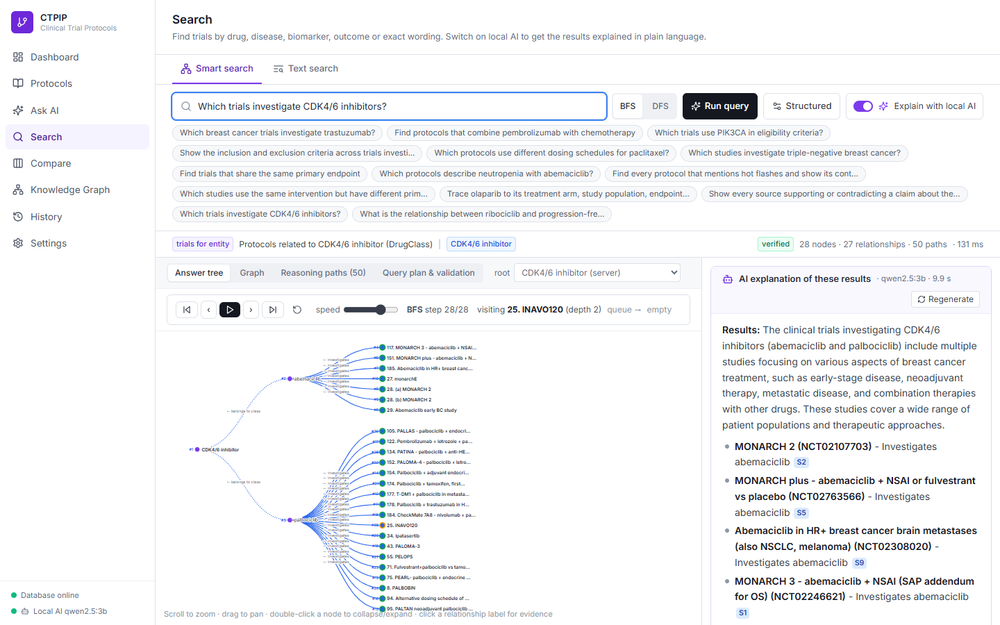

# CTPIP - Clinical Trial Protocol Intelligence Platform

CTPIP reads **breast-cancer clinical trial protocol PDFs** and turns them into a searchable, evidence-linked **knowledge graph** - and a
**local AI assistant** explains them in plain language, so that people without a medical or technical background can understand what a protocol contains.

* **Study any protocol** - a plain-language overview (who can join, treatments and doses, what is measured, safety), an AI explanation, and a Q&A chat.
* **Ask AI** - questions about one protocol or all 187, answered by a local "clinical-trial protocol expert" model using retrieval (RAG) or a research agent.
* **Search** - smart search over verified graph facts, or exact-wording text search; switch on local AI to have results explained.
* **Compare** 2-4 protocols field by field, with an AI explanation of the differences.
* **Explainable by design** - every fact and every AI answer shows its sources (file, page, quote); a grounding check reports which statements are cited, which were matched to a source automatically, and which numbers could not be found in the sources.
* **Runs entirely on your computer** - no cloud service or paid API; the AI model runs locally with [Ollama](https://ollama.com).



| Protocol study (plain language) | AI explanation with citations |
|---|---|
|  |  |
| **Ask AI - research agent** | **Search with AI explanation** |
|  |  |

---

## Quick start (Windows)

### 1. Install once
| Program | Why | Where |
|---|---|---|
| Python 3.11 or newer | backend | python.org (tick **Add python.exe to PATH**) |
| Node.js LTS | builds the web interface | nodejs.org |
| Neo4j Desktop | graph database (includes Java 21) | neo4j.com/download |
| Ollama *(optional)* | local AI model for explanations and Ask AI | ollama.com |
| Git *(optional)* | download the repository | git-scm.com |

### 2. Get the project
```powershell
git clone https://github.com/Jason-Zensar/HLS.git
cd HLS
```

### 3. Create a Neo4j database
1. Open Neo4j Desktop, create a **Local instance**, set a password and start it once.
2. Note the instance folder (contains `bin`, `conf`, `data`) and its Java folder (`...\Neo4jDesktop2\Cache\runtime\zulu21...`).

### 4. Configure
```powershell
Copy-Item .env.example .env
notepad .env
```
Set `NEO4J_PASSWORD`, and (recommended, so `start.bat` can start Neo4j for you) `NEO4J_HOME` and `NEO4J_JAVA_HOME`.

### 5. Start
```powershell
.\start.bat
```
`start.bat` starts Neo4j and Ollama, offers to download the AI model (`qwen2.5:3b`, about 2 GB), creates the Python environment,
builds the web interface, starts the backend on port 8000 (or the next free port) and opens the browser.

**First start:** the 190 dataset PDFs are read automatically into the database and the knowledge graph (about 30-60 minutes; the app can be used meanwhile - progress is shown on the Protocols page).

---

## Local AI

* Default model: `qwen2.5:3b` (fits a 4 GB graphics card). `qwen2.5:7b` or `llama3.1:8b` write richer answers and cite more reliably on larger cards.
* Configure on the **Settings** page: Ollama address/port (default `http://127.0.0.1:11434`), model, temperature, context size; download models from there too.
  Any OpenAI-compatible server (LM Studio, llama.cpp, vLLM) also works.
* Every querying area has an **"Explain with local AI"** switch; the rest of the application works fully without AI.
* How answers stay grounded: retrieval selects numbered sources (protocol passages via full-text search with synonym expansion and
  section-aware ranking, plus validated graph facts); the model is instructed to use only those and cite them `[S1]`; a grounding check then marks
  uncited sentences with their best-matching source `[~S3]`, flags citations to non-existent sources, and lists numbers not found in the sources.
* **Research agent** mode: the model plans tool calls (find protocols, protocol overview, text search, graph search, compare), shows each step, and answers from everything it gathered.

---

## Running without start.bat
```powershell
.\.venv\Scripts\Activate.ps1
cd backend
uvicorn app.main:app --host 127.0.0.1 --port 8000
```
Developer mode for the web interface: `cd frontend; npm install; npm run dev` (http://127.0.0.1:5173). Tests: `cd backend; python -m pytest`.

## Project layout
```
start.bat              one-click launcher (Neo4j, Ollama, Python, web build, backend)
.env.example           settings template -> copy to .env
backend/app/
  api/                 REST API (documents, graph, query, assistant = local AI)
  ingest/              PDF reading, structure, chunking, background worker
  extraction/          dictionary (lexicon), entities, claims
  resolution/          drug-name resolution with human review
  graph/               Neo4j schema, writer, read-only client
  query/               GraphRAG query engine, comparison
  llm/                 local AI: client, retrieval (RAG), agent, protocol brief, glossary, grounding check
backend/tests/         unit tests
frontend/src/          React web interface (pages, components, lib)
docs/                  user manual, how to run, pipeline, dataset, slides, demo video
1-19/ 20-38/ 39-56/ 57-100/ 101-185/   the dataset: 190 protocol PDFs (187 unique)
```
`data/` (SQLite database, stored PDFs, checkpoints, logs) is created on first start and is not part of the repository.

## Documentation
See [`docs/`](docs/README.md): installation and user manual, one-page how-to-run, pipeline explanation, dataset information and catalog, architecture and pipeline slides, demo video.

## Dataset
187 unique breast-cancer clinical trial protocols and statistical analysis plans (19,413 pages; Phase 1-4; 2006-2025) from industry,
academic and cooperative-group sponsors - see `docs/02_Dataset_Information.pdf` and `docs/Dataset_Catalog.csv`. The documents are included for research and education; they remain the property of their respective sponsors.

> CTPIP explains what study documents say. It is not a medical device and does not give medical advice.
